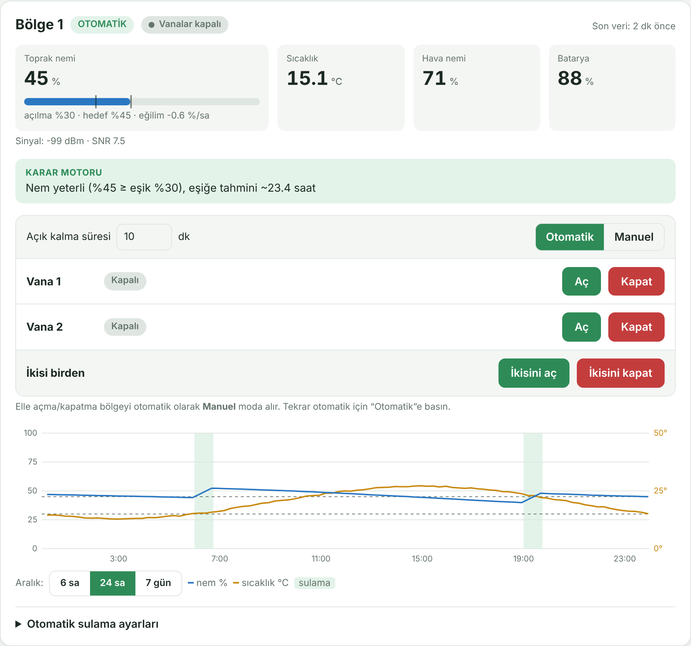

# An Energy-Efficient and Long-Range Smart Irrigation System Using LoRa Network

## 📌 Project Title
An Energy-Efficient and Long-Range Smart Irrigation System Using LoRa Network

## 👥 Project Team & Authors

* Hakan Temiz – Project Manager
* Muhammed Enes Kandemir
* Eren Güler
* Hüseyin Gürgün
* Gökhan Yavuz
* Ömer Bozbay

## 🧪 Novelty & Contributions
This project integrates the following features:

* Long-range wireless communication using LoRa / LoRaWAN
* Off-grid operation enabled by a solar energy module
* Zone-based irrigation and remote-control capability
* Modular and scalable system architecture
* Sensor-driven automated scheduling and decision mechanisms

Expected contributions:

* Significant reduction in labor and water consumption
* Low-cost communication without GSM subscription
* Environmentally friendly irrigation with reduced carbon footprint
* A reference model for future smart agriculture and irrigation projects

## 🔬 Literature Background (Short Overview)
Recent research in smart irrigation highlights:

* Sensor-based control: automatic irrigation based on soil moisture, temperature, light, etc.
* Remote control via GSM / DTMF: irrigation commands sent through GSM networks or DTMF signaling
* Renewable energy-powered irrigation: solar-powered systems for remote agricultural areas

This project combines and advances these approaches by:

* Leveraging LoRa / LoRaWAN, instead of Wi-Fi or GSM alone
* Integrating renewable solar energy as the primary power source
* Providing a modular, scalable, zone-based architecture suitable for large-scale deployment

## 🎯 Project Objective
The main objective of this project is to design and implement an autonomous, remotely controllable irrigation system powered by renewable energy.
Key goals include:

* Performing irrigation at the right time, right amount, and right location
* Reducing labor, water, and energy usage
* Achieving long-distance communication (up to 5–10 km) without GSM or wired infrastructure
* Establishing an autonomous, sensor-assisted, remotely controlled irrigation system
* Promoting environmental sustainability and reduced carbon footprint through solar energy

## 🏗️ System Architecture

```
 Field node (ESP32 + RFM95, 868 MHz)  ──LoRa──►  Gateway  ──►  ChirpStack (LoRaWAN network server)
   sensors + valve relays                                          │
        ▲                                                          │ HTTP integration (uplinks)
        │ downlink (valve commands)                                ▼
        └──────────────  ChirpStack REST API  ◄──────────  Control panel (Node.js, localhost)
                                                              live data · valve control · decision engine
```

## 🖥️ ChirpStack Control Panel

A lightweight web panel (Node.js, **no external dependencies**) that connects to a ChirpStack LoRaWAN network server:

* **Live monitoring:** soil moisture, temperature, air humidity, battery level, and signal quality (RSSI / SNR) from the field node, with a 6 h / 24 h / 7 day history chart.
* **Valve control:** each valve can be opened or closed individually, or both at once, with a timed auto-close. Commands are sent as hex downlinks through the ChirpStack REST API.
* **Decision engine (rule-based):** automatic irrigation based on soil-moisture thresholds, with
  * temperature-adjusted threshold (waters earlier in hot weather),
  * allowed irrigation hours and a minimum interval between cycles,
  * rain and low-temperature lock-outs (when the node reports these values),
  * learning of the soil's moisture-rise rate to plan the next irrigation duration,
  * fault detection (valve open but moisture not rising) and loss-of-data protection,
  * a hard maximum run time as a safety net.
  Every decision is shown in the interface together with its reason.
* **Dry-run mode** for testing without sending anything to the devices.



*The control panel, shown here with simulated sensor data.*

Setup and usage: see [`1_Software/ChirpStack_Panel/README.md`](1_Software/ChirpStack_Panel/README.md).

## 📡 Field Node Firmware
ESP32 + RFM95 (SX1276) nodes running LoRaWAN (EU868, OTAA, Class A) with the MCCI LMIC library. The node sends a periodic uplink and executes valve commands received as downlinks:

| Hex | Action |
|---|---|
| `01` / `02` | Valve 1 open / close |
| `03` / `04` | Valve 2 open / close |
| `05` / `06` | Both valves open / close |

Firmware sources are in `1_Software/ChirpStack_Panel/firmware/`. Keys (`APPEUI`, `DEVEUI`, `APPKEY`) are left blank as templates; use your own and never commit real keys.

## 📦 Repository Structure

```
├── 1_Software/                        # Control software, web interface, and embedded code
│   ├── ChirpStack_Panel/              # LoRaWAN / ChirpStack control panel (Node.js)
│   │   ├── server.js                  # Server: ChirpStack bridge, storage, decision engine
│   │   ├── public/index.html          # Web interface
│   │   ├── decoder.js                 # Payload decoder (if no ChirpStack codec)
│   │   ├── simulate.js                # Simulated uplinks for testing without hardware
│   │   ├── config.example.json        # Example settings (copy to config.json)
│   │   ├── firmware/                  # ESP32 + RFM95 node firmware (LMIC)
│   │   └── README.md                  # Setup and usage
│   ├── chart.js/                      # Chart.js library
│   ├── acu.ico                        # Favicon
│   ├── grafik.php                     # Graph visualization
│   ├── grafik_veri.php                # Graph data provider
│   ├── headerlogotr.png               # Logo image
│   ├── index.php                      # Main control panel
│   ├── komutal.php                    # Receive commands/data
│   ├── komutver.php                   # Send commands to devices
│   ├── readme.md                      # Optional internal documentation
│   ├── schedule_ekle.php              # Scheduling interface
│   ├── style.css                      # UI styling
│   ├── verial.php                     # Data receiving script
│   ├── YedoksC.ino                    # Embedded firmware (ESP32/Arduino)
│   └── zaman_kontrol.php              # Time-based trigger logic
│
├── 2_Report/
│   └── LoRa_Rapor_30July.pdf          # Project report
│
├── 3_Media/
│   └── Images/                        # Photos and screenshots of the system
│
└── README.md                          # This file
```

## 🚀 Quick Start (control panel)

Requires **Node.js 22+**; no `npm install` is needed.

```bash
cd 1_Software/ChirpStack_Panel
cp config.example.json config.json     # Windows: copy config.example.json config.json
# edit config.json: ChirpStack API URL and API token; keep "dryRun": true for the first test
node server.js                         # then open http://localhost:3000
node simulate.js                       # (optional, second terminal) feed simulated sensor data
```

`config.json` holds secrets (API token) and is listed in `.gitignore`.
